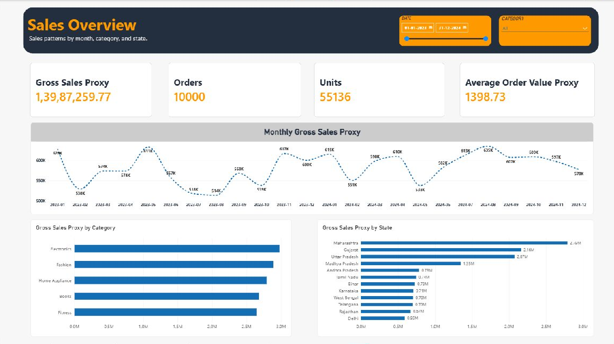
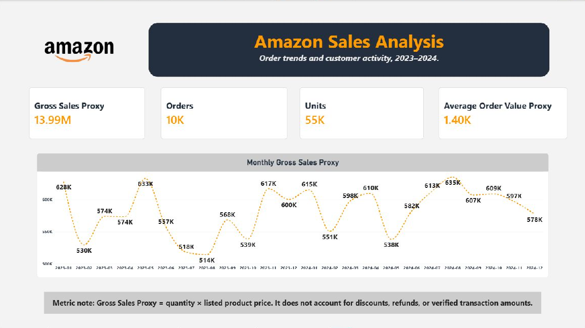
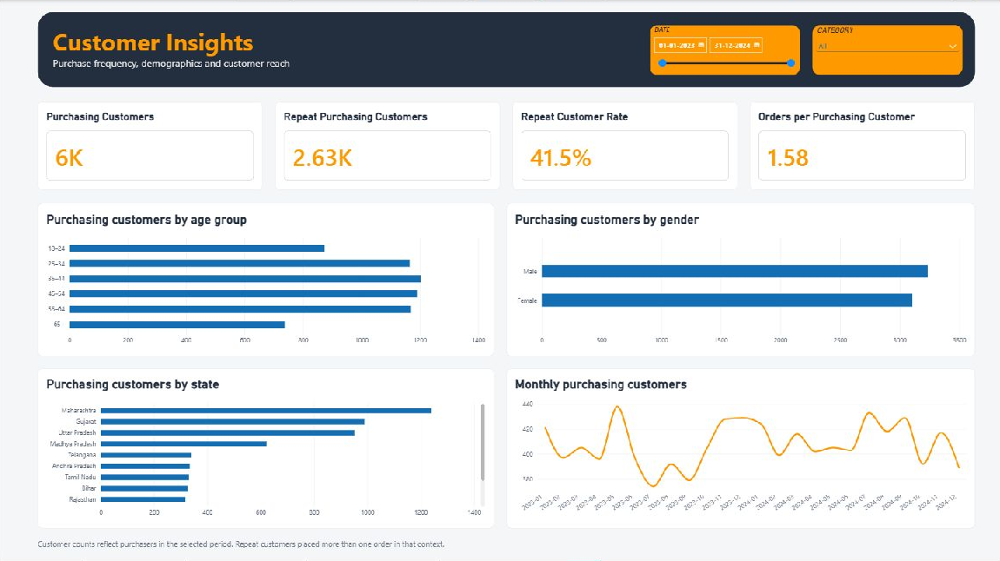
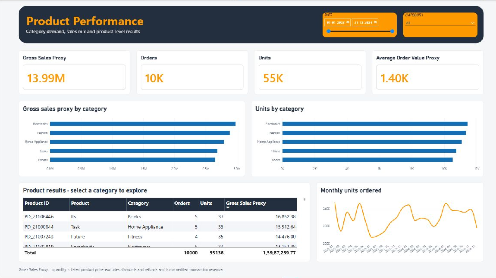
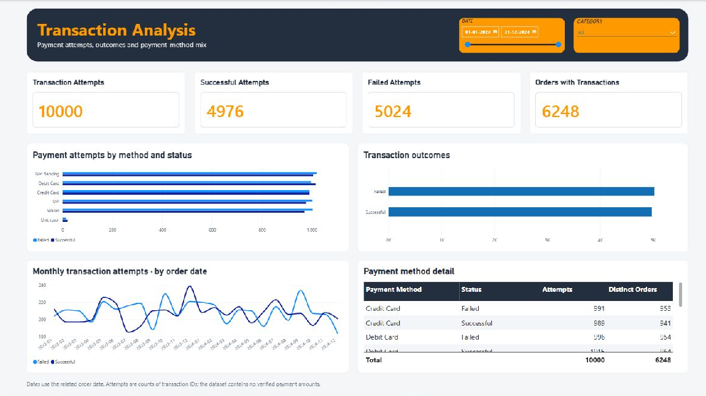

# Amazon Sales Analytics

A data analytics project using **Python, MySQL, and Power BI** to explore customer purchasing behavior, product demand, sales patterns, and payment attempts from January 2023 through December 2024.



## Key results

These figures were recomputed from the source CSVs for the full reporting period.

| Metric | Result |
| --- | ---: |
| Orders | 10,000 |
| Units ordered | 55,136 |
| Gross sales proxy | 13,987,259.77 |
| Average order value proxy | 1,398.73 |
| Purchasing customers | 6,340 |
| Repeat purchasing customers | 2,633 |
| Repeat customer rate | 41.53% |
| Orders per purchasing customer | 1.5773 |
| Products with at least one order | 6,266 |
| Transaction attempts | 10,000 |
| Successful attempts | 4,976 |
| Failed attempts | 5,024 |

**Gross sales proxy** is quantity multiplied by the listed product price, summed across orders. It excludes discounts, refunds, taxes, and verified settlement amounts. The source files do not explicitly identify a currency, so amounts are presented without a currency symbol.

## Business questions

- How do order volumes, units, and sales proxies change by month and year?
- Which categories, products, and states contribute the most activity?
- How many customers purchase repeatedly, and how are purchasers distributed by age and gender?
- How do payment attempts and outcomes vary by method?
- What do return records, ratings, and subscription intervals reveal about data quality and service activity?

## Tools and workflow

| Component | Role |
| --- | --- |
| Python and pandas | CSV profiling, deduplication, type conversion, relationship checks, and exploratory analysis |
| MySQL | Staging tables, typed dimensions and facts, integrity constraints, and analytical queries |
| Power BI Desktop | Semantic model, interactive slicers, KPI cards, charts, and detail tables |

The notebook and SQL script implement **parallel preparation and analysis paths** against the source data. The notebook does not automatically export cleaned tables or load MySQL. The SQL script expects its staging tables to be populated separately.

## Project files

```text
.
├── README.md
├── Amazon_sales.ipynb
├── Amazon.sql
├── Amazon_Sales_Dashboard.pbix
├── screenshots/
│   ├── 01-introduction.png
│   ├── 02-sales-overview.png
│   ├── 03-customer-insights.png
│   ├── 04-product-performance.png
│   └── 05-transaction-analysis.png

```

The following input files are required separately in an `Import Data` directory:

| CSV file | Raw rows | Purpose |
| --- | ---: | --- |
| `Customer.csv` | 10,184 | Customer demographics and geography |
| `Delievry.csv` | 325 | Delivery partner attributes and ratings |
| `Orders.csv` | 10,000 | Order dates, customer and product references, and quantities |
| `Products.csv` | 10,000 | Product catalog, category, and listed price |
| `Ratings.csv` | 10,000 | Product and delivery or service responses |
| `Returns_refund.csv` | 2,000 | Return and refund records and reasons |
| `Subscription_Details.csv` | 10,036 | Customer subscription intervals |
| `Subscription_Plan.csv` | 3 | Subscription plan descriptions |
| `Transactions.csv` | 10,000 | Payment methods and attempt statuses |

`Delievry.csv` retains the filename spelling used by the source project. Raw CSVs are not included in this workspace. Customer inputs contain address and mobile fields; dashboard screenshots and the report use aggregate results.

## Data preparation and validation

The [Python notebook](Amazon_sales.ipynb) performs the following steps:

1. Imports all CSV columns as strings and profiles missing values and exact duplicates.
2. Checks repeated customer and delivery IDs for conflicting attributes before removing identical copies.
3. Validates primary keys and eight child-to-parent relationships.
4. Converts numeric and date fields while checking conversion failures.
5. Tests age, price, quantity, rating, and subscription interval validity.
6. Fills selected missing text fields and retains missing numeric ratings.
7. Enriches orders with validated many-to-one product and customer joins.
8. Produces monthly, category, product, state, payment, return, rating, and subscription summaries.

| Data quality finding | Treatment |
| --- | --- |
| 184 exact duplicate customer rows | Removed, leaving 10,000 customer records |
| 25 exact duplicate delivery rows | Removed, leaving 300 delivery partners |
| 5,011 missing coupon values | Labeled `No Coupon` |
| 14 missing product names | Labeled `Unknown Product` |
| 33 missing payment methods | Labeled `Unknown` |
| 22 missing product ratings and 29 missing service ratings | Retained as missing and excluded from averages |
| 20 missing delivery partner ratings after deduplication | Retained as missing |
| 1,177 reversed subscription intervals | Flagged and excluded from duration and active interval summaries |

After deduplication, the tested entity keys are unique and the eight tested relationships have no orphan IDs. Tested numeric and date conversions produce no conversion failures. The interpretation of blank coupons as `No Coupon` remains a source-data assumption.

## SQL model

The [SQL script](Amazon.sql) defines text-based staging tables and the following analytical tables:

| Layer | Tables |
| --- | --- |
| Dimensions | `dim_customer`, `dim_product`, `dim_delivery`, `dim_subscription_plan` |
| Facts | `fact_orders`, `fact_transactions`, `fact_ratings`, `fact_returns`, `fact_subscriptions` |
| Power BI calendar | `Dim_Date` |

Orders reference customer, product, and delivery dimensions. Transactions, ratings, and returns reference orders through `Or_ID`. Subscriptions connect customers and plans through separate subscription records.

Order IDs are unique in the supplied order data, while transactions, ratings, returns, and subscriptions retain their own record grains. Aggregate child facts before joining them to order amounts to avoid multiplying sales proxies.

## Dashboard pages

Open the [Power BI report](Amazon_Sales_Dashboard.pbix) to explore the pages interactively. The four analytical pages include date and category slicers.

### Introduction

Project context, headline order metrics, a monthly sales proxy trend, and the metric definition.



### Sales Overview

Sales proxies, orders, units, and average order value proxy, with monthly, category, and state comparisons.

The overview screenshot appears at the top of this README.

### Customer Insights

Purchasing customers, repeat purchasers, repeat rate, and purchase frequency, supported by age, gender, state, and monthly views.



### Product Performance

Category sales and unit comparisons, a product-level results table with product IDs, and a monthly units trend.



### Transaction Analysis

Payment attempts, successful and failed attempts, distinct related orders, payment method comparisons, and monthly trends by related order date.



## Analytical findings

- **Sales proxy growth:** 2024 contributes 7,134,273.24, up 4.10% from 6,852,986.53 in 2023. Orders grow by 0.92% and units by 2.67%.
- **Category mix:** Electronics leads with 2,977,529.58 in sales proxy and 11,450 units. Fashion has the most orders at 2,060.
- **Geographic concentration:** Maharashtra, Gujarat, and Uttar Pradesh together contribute 50.21% of the sales proxy.
- **Repeat purchasing:** 2,633 repeat purchasers generate 6,293 orders, representing 62.93% of all orders.
- **Catalog dispersion:** The ten leading individual product IDs contribute only 1.01% of the total sales proxy.
- **Payment coverage:** The 10,000 attempts cover 6,248 distinct orders. The 49.76% attempt success rate is not a final order success rate.
- **Returns:** 2,000 return or refund records affect 1,820 orders, an incidence of 18.2%.
- **Subscriptions:** Excluding 1,177 invalid intervals leaves 8,859 valid subscription records. At 31 December 2024, 5,036 valid active records represent 3,960 distinct customers.

## Run the project

### Python

Use a Python environment with pandas and JupyterLab:

```bash
python -m pip install pandas jupyterlab
jupyter lab Amazon_sales.ipynb
```

Place the nine CSV files in `Import Data`, then update the notebook's `DATA` variable to your local path. For example, when Jupyter is launched from the repository root:

```python
from pathlib import Path

DATA = Path("Import Data")
```

Run the notebook cells in order. Check the validation outputs before interpreting the exploratory summaries.

### MySQL

Use MySQL 8 or later for the window functions in the subscription median query.

1. Run the database and staging table definitions in `Amazon.sql`.
2. Import each CSV into its matching staging table, mapping source headers to the SQL column names where necessary.
3. Run the analytical dimension and fact table definitions and load statements in dependency order.
4. Run the row-count, integrity, and aggregate queries and compare them with the results above.

The script does not include the CSV import step and is not an idempotent migration. Inspect the existing database state before rerunning `CREATE TABLE` or `INSERT` statements.

### Power BI

1. Open `Amazon_Sales_Dashboard.pbix` in Power BI Desktop.
2. Review the five report pages and use the date and category slicers.
3. For a data refresh, review the existing Power Query connections and configure the local source access required by those connections.
4. Reset slicers to the full reporting period when comparing values with this README.

## Metric definitions and limitations

| Metric | Definition or interpretation |
| --- | --- |
| Purchasing customers | Distinct customers with an order in the selected context |
| Repeat purchasing customers | Purchasing customers with more than one order in that context |
| Repeat customer rate | Repeat purchasers divided by purchasers; not cohort retention |
| Orders per purchasing customer | Orders divided by purchasers |
| Transaction attempts | Count of nonblank transaction IDs |
| Orders with transactions | Distinct order IDs represented in the transaction records |
| Attempt success rate | Successful attempts divided by all attempts |
| Return incidence | Distinct orders with a return or refund record divided by all orders |

- Dashboard cards use rounded display units: `6K` purchasing customers represents 6,340, not exactly 6,000.
- Distinct customers, orders, and subscribers can overlap across groups or periods. Their group totals are not always additive.
- The transaction file has no payment event timestamps or settled amounts. Monthly transaction charts use the related order date.
- An order can have multiple attempts and both successful and failed records. Missing transaction records do not establish unpaid orders.
- Missing numeric ratings are excluded from averages; response counts should accompany rating summaries.
- The supplied files do not establish official Amazon business performance, profitability, causal effects, or future trends.

## Report and verification

Read the [25-page project analysis report](D:/amazon/Amazon_Sales_Analytics_Report.pdf) for the technical review, all five screenshots, detailed findings, and prioritized recommendations.

The review reran all 24 notebook code cells against the source CSVs and inspected the SQL statements, PBIX visual definitions, filters, model diagram table names, and screenshots. SQL was reviewed statically rather than executed against a live MySQL instance. PBIX visual metadata does not constitute a complete audit of embedded DAX formulas or relationship filter directions.

The main next steps are to resolve invalid subscription intervals, document payment coverage, automate reconciliation assertions, make loading repeatable, and export the semantic model for a complete DAX and relationship review.
